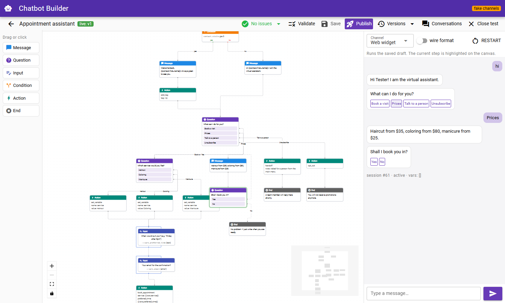
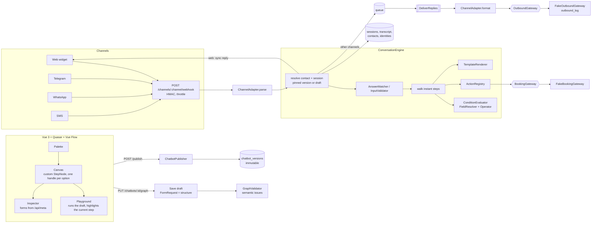
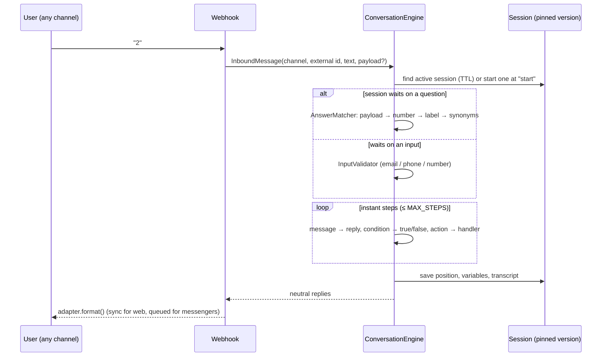

# Chatbot Builder

A visual scenario editor (Vue 3 + Vue Flow) and a channel-agnostic conversation engine (Laravel). A scenario is a JSON graph of steps. Before publishing, it is checked for structural problems. It is then published as an immutable version and executed the same way in a web widget, Telegram, WhatsApp or SMS.

> All integrations are simulated. The channel adapters produce the exact provider payloads, but a fake gateway writes them to an `outbound_log` table instead of calling an API. Bookings go to a fake booking system. All data is synthetic.



*The demo scenario in the editor. The playground on the right runs the draft; the current step ("Shall I book you in?") is highlighted on the canvas.*

## What it demonstrates

| Topic | How |
|---|---|
| Scenario as data | One JSON format shared by the editor (Vue Flow nodes and edges) and the engine (`Graph`) |
| Static analysis of a graph | `GraphValidator` finds: missing or duplicate start, dangling edges, unknown or doubly connected outputs, unconnected condition branches, **loops that never wait for the user**, unreachable steps, bad step content |
| Safe releases | Draft → immutable `chatbot_versions`. Running conversations stay on the version they started on |
| Channel independence | The engine returns neutral `Reply` objects. Adapters render buttons as a Telegram inline keyboard, a WhatsApp numbered list, compact SMS text or widget JSON |
| Robust answer matching | Button payload → option number → label → synonyms, so "2", "Prices!" and "how much is it?" land on the same branch |
| Extensibility | Actions and channels are tagged strategies (`ActionHandler`, `ChannelAdapter`). The editor palette is built from `GET /api/meta`, nothing is hardcoded |
| Runtime guards | Step budget per message, retry limit for unrecognised answers, session TTL, hand-off mode in which the bot stays silent |

## Architecture



### Graph format

```json
{
  "nodes": [
    { "id": "start", "type": "start", "position": { "x": 0, "y": 0 }, "data": {} },
    { "id": "menu", "type": "question", "position": { "x": 0, "y": 120 },
      "data": { "text": "What can I do for you?",
                "options": [ { "id": "book", "label": "Book a visit", "synonyms": ["appointment"] },
                             { "id": "prices", "label": "Prices" } ] } },
    { "id": "email", "type": "input", "position": { "x": 0, "y": 260 },
      "data": { "text": "Your email?", "variable": "email", "validation": "email" } }
  ],
  "edges": [
    { "id": "start:next", "source": "start", "sourceHandle": "next", "target": "menu" },
    { "id": "menu:option:book", "source": "menu", "sourceHandle": "option:book", "target": "email" }
  ]
}
```

| Step | Waits for the user | Outputs | Data |
|---|---|---|---|
| `start` | – | `next` | – |
| `message` | – | `next` | `text` |
| `question` | yes | `option:{id}` per option | `text`, `options[]`, `retry_text`, `max_retries` |
| `input` | yes | `next` | `text`, `variable`, `validation` (text, email, phone, number) |
| `condition` | – | `true`, `false` | `rules[] {field, operator, value}`, `match` (all, any) |
| `action` | – | `next` | `action`, `params` (templates allowed) |
| `end` | – | – | optional `text` |

Fields usable in conditions: `contact.visits`, `contact.tags`, `contact.name`, `contact.email`, `contact.phone`, `session.channel`, `time.hour`, `time.weekday`, `vars.*`.

Actions: `set_variable`, `add_tag`, `book_appointment`, `handoff`, `opt_out`.

### One message through the engine



## Key design decisions

- **Two levels of validation.** The FormRequest only checks the *shape* (types, sizes) and rejects garbage with a 422. The `GraphValidator` checks *meaning* and returns issues instead of failing, so a half-finished draft can always be saved. Publishing is blocked while any error is left.
- **Infinite-loop detection.** A cycle is legal if it passes through a waiting step, because the user answers on every lap. A cycle made only of instant steps would spin forever. The validator runs a DFS over instant steps only. The engine also has a `MAX_STEPS` budget, because test sessions run unvalidated drafts.
- **Version pinning.** A session stores `chatbot_version_id`. Publishing v2 doesn't change the flow for someone halfway through v1. The playground uses `is_test` sessions that always run the latest draft.
- **One identity per channel.** `contact_identities (channel, external_id)` maps a Telegram chat id, a phone number or a widget visitor id to one contact. Conditions then see the same CRM attributes whichever channel the person writes from.
- **Sync for web, async for messengers.** The widget gets its replies in the HTTP response. Messenger and SMS webhooks are acknowledged immediately; the replies of one turn are delivered by one queued job (retries with backoff, order preserved).
- **Webhooks never cause retry storms.** A message for a channel without a published bot is acknowledged with `202`. Signatures are HMAC-SHA256 with constant-time comparison.

## API

| Method | Endpoint | Purpose |
|---|---|---|
| GET | `/api/meta` | Step types, actions with their parameter schema, condition fields, operators, channels |
| GET/POST | `/api/chatbots` | List / create (starter graph) |
| GET/PATCH/DELETE | `/api/chatbots/{id}` | Detail (draft graph, issues, unpublished-changes flag) |
| PUT | `/api/chatbots/{id}/graph` | Save the draft → `{issues}` |
| POST | `/api/chatbots/validate` | Validate a graph without saving |
| POST | `/api/chatbots/{id}/publish` | New immutable version, or 422 with issues |
| GET | `/api/chatbots/{id}/versions` | Versions with active conversation counts |
| PUT | `/api/chatbots/{id}/channels` | Bind channels (a channel moves away from its previous bot) |
| POST | `/api/chatbots/{id}/simulate` (`/reset`) | Playground: replies, wire payload per channel, current step |
| GET | `/api/chatbots/{id}/sessions` | Conversations with status statistics |
| GET | `/api/sessions/{id}` | Transcript, variables |
| POST | `/api/sessions/{id}/close` | Operator closes a hand-off |
| POST | `/api/channels/{web\|telegram\|whatsapp\|sms}/webhook` | Inbound messages (HMAC for everything except web) |

## Running it

```bash
docker compose up -d --build
```

- Editor: http://localhost:5174
- API: http://localhost:8081/api

The first start migrates and seeds:
- the published "Appointment assistant", bound to all four channels;
- 60 synthetic conversations, produced by scripted users talking to the **real engine**: bookings, typos, retries, hand-offs, unsubscribes, abandoned chats;
- a "Feedback survey" draft with deliberate mistakes, to show the validator on the canvas.

Try a messenger webhook by hand:

```bash
body='{"message":{"chat":{"id":42},"text":"hi"}}'
sig=$(printf '%s' "$body" | openssl dgst -sha256 -hmac change-me | cut -d' ' -f2)
curl -X POST localhost:8081/api/channels/telegram/webhook -H "Content-Type: application/json" -H "X-Signature: $sig" -d "$body"
# replies end up in the outbound_log table in Telegram Bot API format
```

## Tests

```bash
docker compose exec app vendor/bin/pest
```

The suite (Pest) covers:
- **Validator:** every rule, plus the demo scenario passing clean.
- **Engine:** the full booking path, branching on contact data, retries and giving up, input validation, hand-off silence, opt-out, numbered answers over SMS, session expiry, **version pinning across a publish**, the step budget against a runaway draft, transcripts.
- **API:** draft vs publish, versions, channel moves, the playground wire format.
- **Signed webhooks:** queued delivery, Telegram callbacks, unbound channels.
- **Adapters:** keyboard / numbered list / SMS length.
- **Operators and answer matching:** data-driven cases.
- **The seeder.**

## Project layout

```
backend/app/Chatbot/
  Graph/        Graph, Node, GraphValidator, Issue
  Engine/       ConversationEngine, AnswerMatcher, InputValidator, TemplateRenderer, Reply, InboundMessage
  Conditions/   FieldResolver, ConditionEvaluator
  Actions/      ActionHandler, ActionRegistry, Handlers/*
  Channels/     ChannelAdapter, Web/Telegram/WhatsApp/Sms adapters, ChannelRegistry
  Contracts/    BookingGateway, OutboundGateway       ← integration seams
  Fakes/        FakeBookingGateway, FakeOutboundGateway
  Scenarios/    StarterScenario (empty + demo graphs)
  ChatbotPublisher.php
frontend/src/
  components/nodes/StepNode.vue   custom Vue Flow node: handles per option, issue badges, live highlight
  components/NodeInspector.vue    forms generated from backend metadata
  components/Playground.vue       chat simulator with wire-format view
  stores/editor.ts                graph state, one-edge-per-output rule, save, validate, publish
```

## Extending

- **New action:** implement `ActionHandler` (key, label, parameter schema, `validate()`, `handle()`) and add it to `AppServiceProvider::ACTIONS`. It shows up in the editor and the validator automatically.
- **New channel:** implement `ChannelAdapter` (`rules`, `parse`, `format`), add a `ChannelType` case and register it in `AppServiceProvider::CHANNELS`.
- **Real providers:** bind real `OutboundGateway` and `BookingGateway` implementations instead of the fakes.

## Out of scope

- Authentication and multi-tenancy: the API is open in this demo.
- An operator inbox UI: a hand-off can be closed from the transcript dialog.
